# Active Directory & Hybrid Identity Lab

## Project Overview

This project demonstrates the deployment of an on-premises Microsoft Active Directory environment and its integration with Microsoft Entra ID to create a functional hybrid identity environment.

The lab was designed to simulate a small enterprise identity infrastructure where users, groups, organizational units, security policies, domain-joined endpoints, and cloud identities are centrally managed.

The environment includes a Windows Server domain controller, Active Directory Domain Services, DNS, Group Policy, a Windows 11 domain-joined client, and Microsoft Entra Cloud Sync.

The final result demonstrates the full identity path from an on-premises Active Directory user to a synchronized Microsoft Entra ID identity.

---

## Business Problem

Organizations operating in hybrid environments often maintain traditional Active Directory infrastructure while also using Microsoft Entra ID for cloud authentication, SaaS applications, Microsoft 365, and modern identity security.

Without a properly designed identity environment, organizations may experience:

- Inconsistent user and group management
- Weak password and account lockout controls
- Excessive administrative privileges
- Unmanaged endpoints
- Separate on-premises and cloud identities
- Increased administrative overhead
- Poor visibility into identity synchronization

This project demonstrates how an organization can establish a structured Active Directory environment and extend those identities into Microsoft Entra ID.

---

## Project Objectives

The primary objectives of this project were to:

- Deploy Active Directory Domain Services and DNS
- Create a new Active Directory forest and domain
- Design an organizational unit structure
- Create users and security groups
- Assign users to role-appropriate groups
- Separate privileged administrative identities
- Implement Group Policy security controls
- Configure an account lockout policy
- Deploy and domain-join a Windows 11 workstation
- Validate domain-user authentication
- Verify Group Policy application on the client
- Configure Microsoft Entra Cloud Sync
- Scope synchronization to the Employees OU
- Enable password hash synchronization
- Synchronize an on-premises identity into Microsoft Entra ID
- Validate hybrid identity attributes in Entra ID

---

## Environment and Tools

### On-Premises Environment

- Windows Server
- Active Directory Domain Services
- Active Directory Users and Computers
- DNS Server
- Group Policy Management
- Windows 11 Pro
- Oracle VirtualBox

### Cloud Environment

- Microsoft Entra ID
- Microsoft Entra Connect
- Microsoft Entra Cloud Sync
- Microsoft Entra Provisioning Agent
- Password Hash Synchronization

### Domain

`kaleblab.local`

### Core Systems

| System | Purpose |
|---|---|
| DC01 | Domain Controller, Active Directory, DNS, Group Policy, Cloud Sync Agent |
| CLIENT01 | Windows 11 Pro domain-joined employee workstation |
| Microsoft Entra ID | Cloud identity directory and hybrid identity target |

---

# Implementation

## 1. Active Directory Domain Services and DNS Deployment

The lab began with the deployment of Active Directory Domain Services and DNS on DC01.

Installing these services established the core infrastructure required for centralized authentication, authorization, name resolution, and Group Policy management.

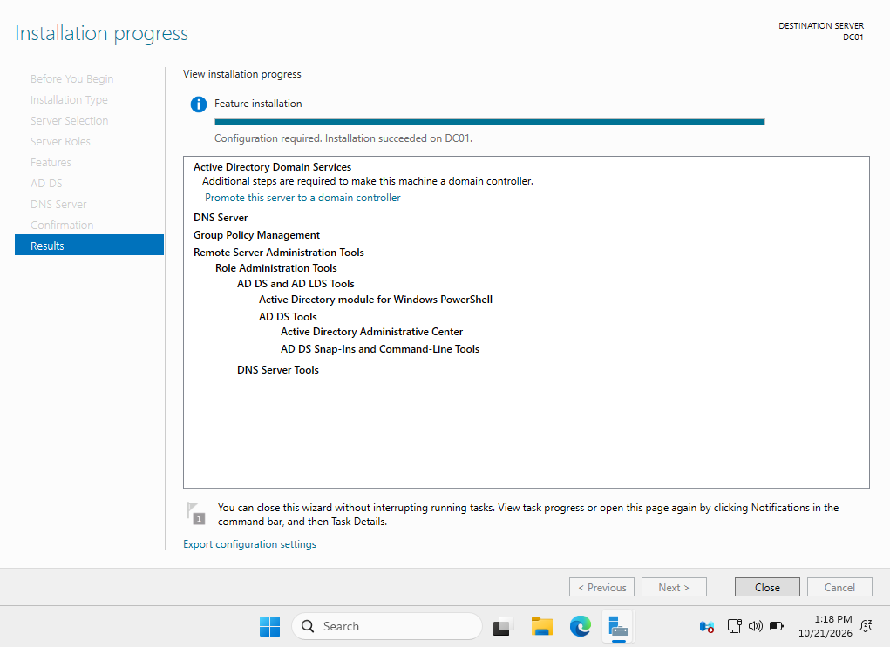

---

## 2. Active Directory Domain Creation

A new Active Directory forest was created using the domain:

`kaleblab.local`

DC01 was promoted to the domain controller for the new forest.

This created the centralized identity authority for the on-premises environment.

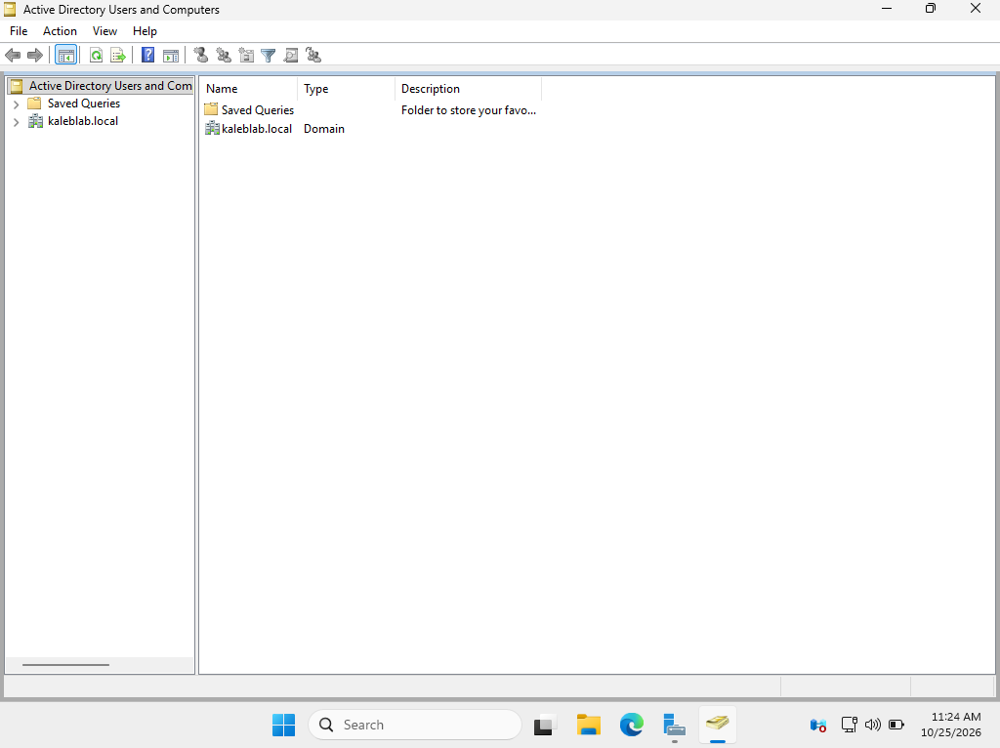

---

## 3. DNS Resolution Verification

DNS functionality was validated after domain creation to ensure that the domain controller could correctly resolve the Active Directory domain.

Proper DNS configuration is critical to Active Directory because authentication, domain joins, Group Policy, and service discovery depend on DNS.

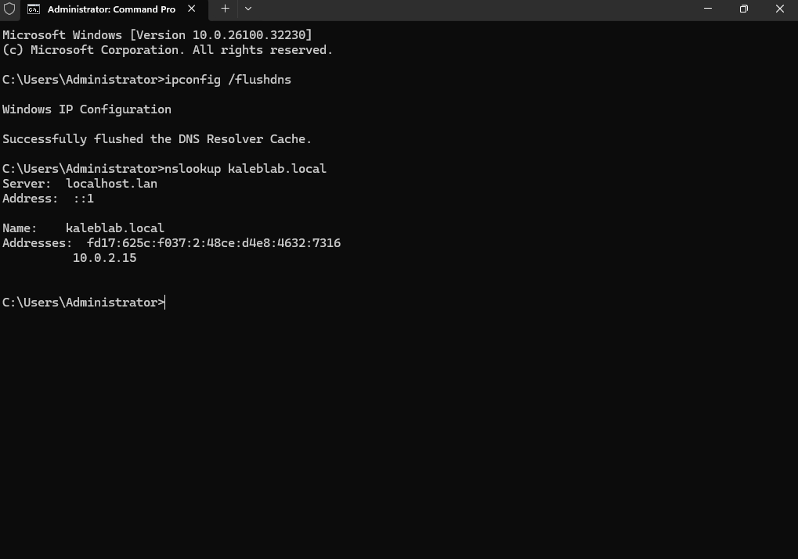

---

## 4. Organizational Unit Design

An organizational unit structure was created to logically organize users and support scalable identity administration.

The environment separates employee identities into organizational units that can be used for administration, Group Policy targeting, and future lifecycle automation.

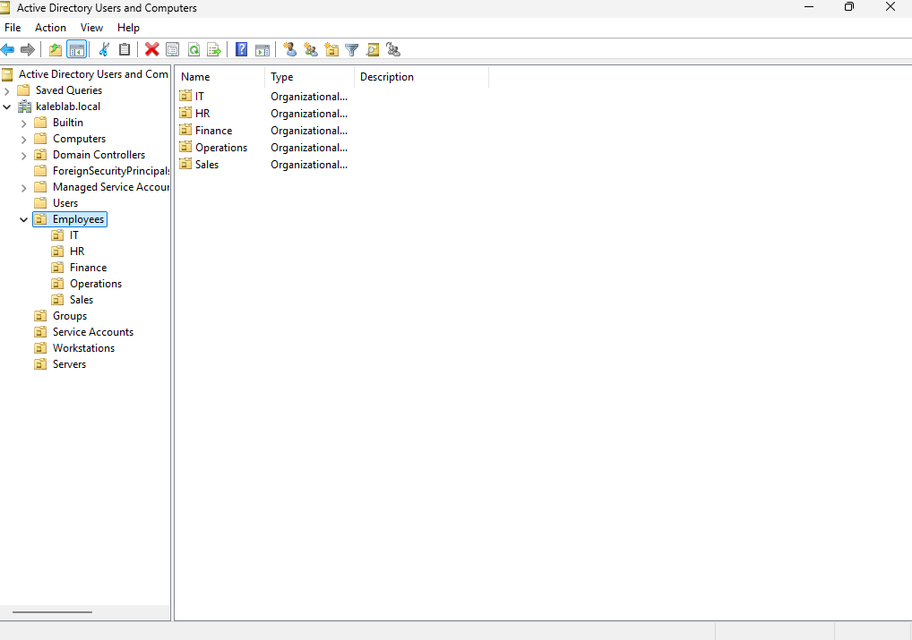

This structure also became important later in the project when Microsoft Entra Cloud Sync was scoped specifically to the Employees OU.

---

## 5. User and Group Membership Management

Active Directory users were created and assigned to appropriate security groups based on organizational role.

Group-based access management allows permissions to be assigned to groups instead of directly to individual users, making the environment easier to manage and scale.

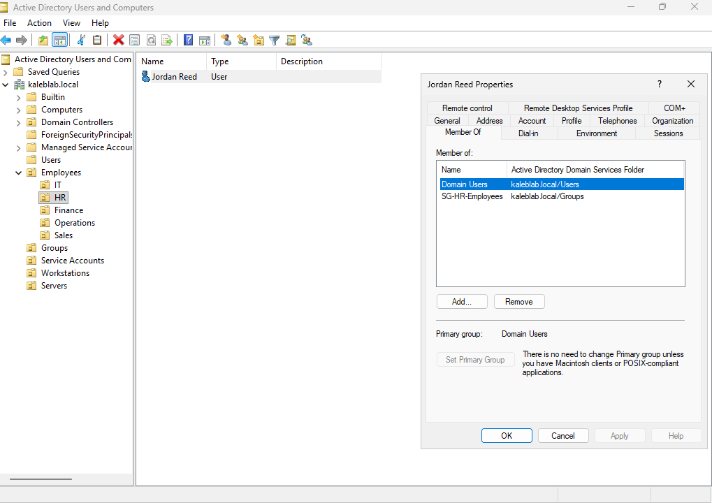

This approach follows the IAM principle of managing access through role and group membership rather than one-off user permissions.

---

## 6. Privileged Administrative Access

Privileged accounts were separated from standard employee access and assigned to administrative security groups.

This reduces unnecessary exposure of privileged permissions and supports the principle of least privilege.

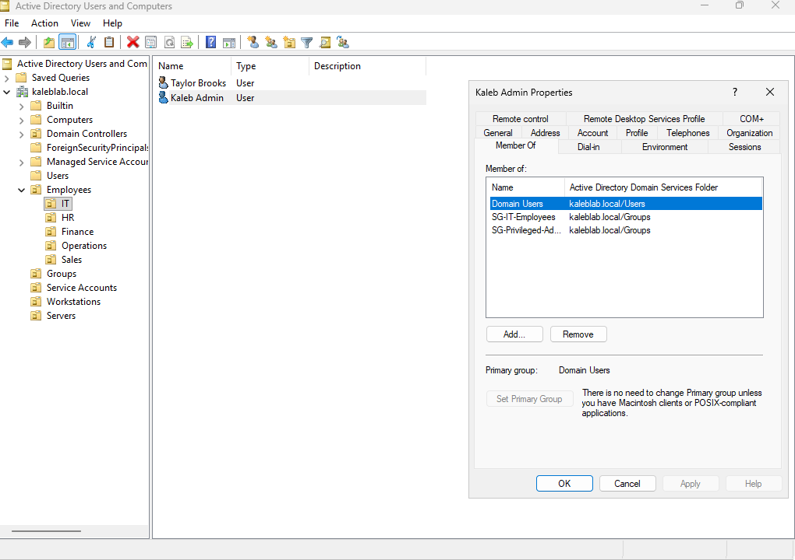

Separating privileged identities from normal employee accounts is an important identity-security practice because administrative credentials represent a higher-risk target.

---

## 7. Employee Security Baseline Group Policy

A Group Policy Object named:

`Employee Security Baseline`

was created to enforce security settings for employee systems and identities.

Group Policy provides centralized configuration enforcement across domain-joined systems.

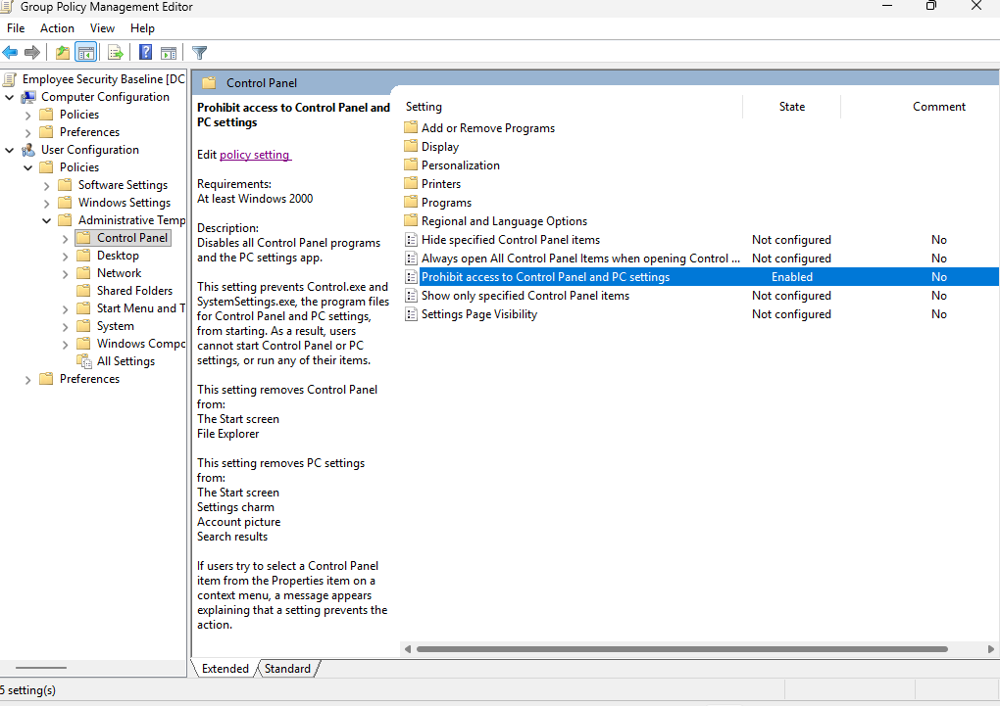

The policy demonstrates how administrators can enforce consistent security requirements without manually configuring every workstation.

---

## 8. Account Lockout Policy

An account lockout policy was implemented to reduce the risk of password-guessing and brute-force attacks.

The configured policy included:

- Account lockout threshold: 5 invalid sign-in attempts
- Account lockout duration: 15 minutes
- Reset account lockout counter after: 15 minutes

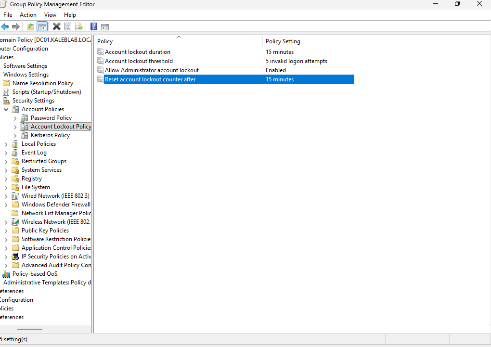

This provides a basic security control against repeated unauthorized authentication attempts.

---

# Domain-Joined Client Validation

## 9. Windows 11 Domain Join

A Windows 11 Pro workstation was deployed as `CLIENT01`.

The workstation was configured to use DC01 for DNS and successfully joined to:

`kaleblab.local`

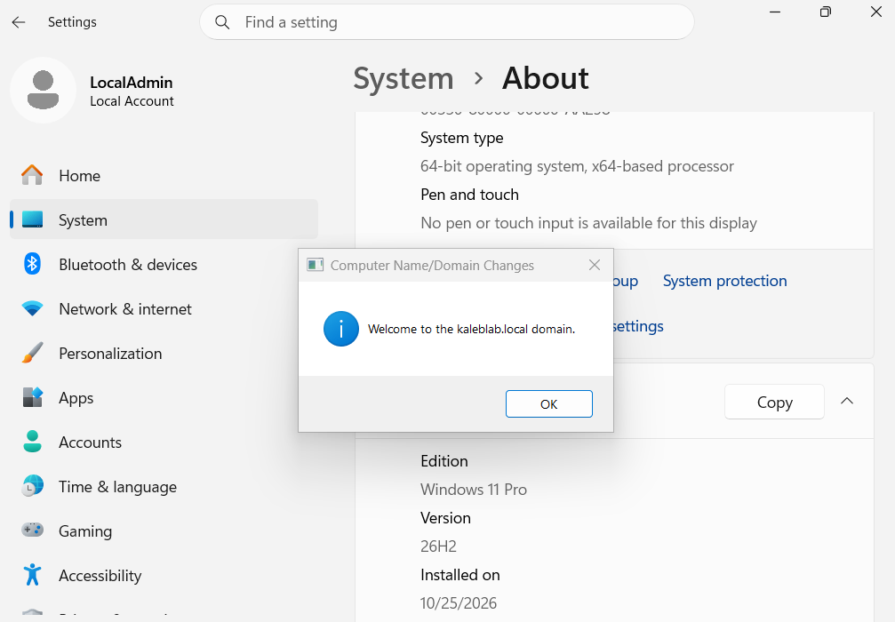

This validated communication between the workstation and the domain controller.

---

## 10. Domain User Authentication

After CLIENT01 joined the domain, the workstation was used to authenticate with the Active Directory account for Andre Wilson.

The `whoami` command confirmed that the session was authenticated using the `KALABLAB` domain rather than a local Windows account.

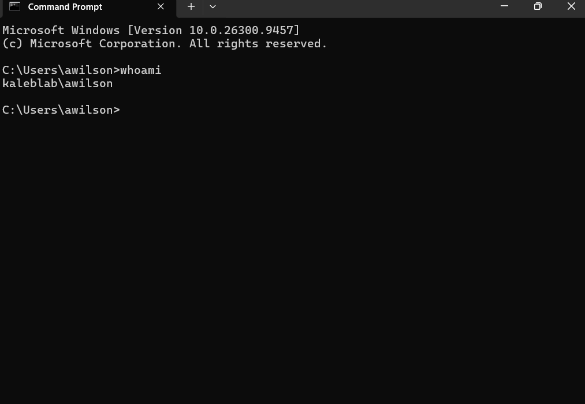

This demonstrated successful centralized Active Directory authentication from an employee workstation.

---

## 11. Group Policy Validation

The `gpresult /r` command was used on CLIENT01 to confirm that domain Group Policy was successfully applied to the workstation and domain user.

The results confirmed application of the:

`Employee Security Baseline`

policy.

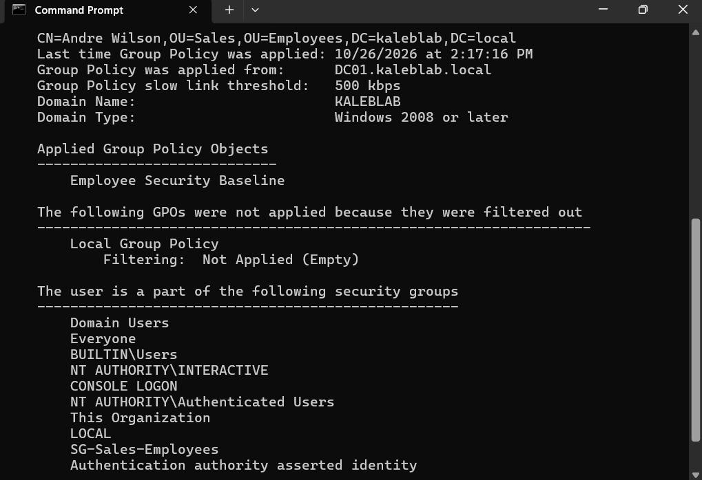

The output also demonstrated that the authenticated user inherited domain group memberships and policies from Active Directory.

---

## 12. Active Directory Computer Object

After the workstation was renamed to `CLIENT01`, Active Directory Users and Computers was used to confirm that the computer existed as a managed domain object.

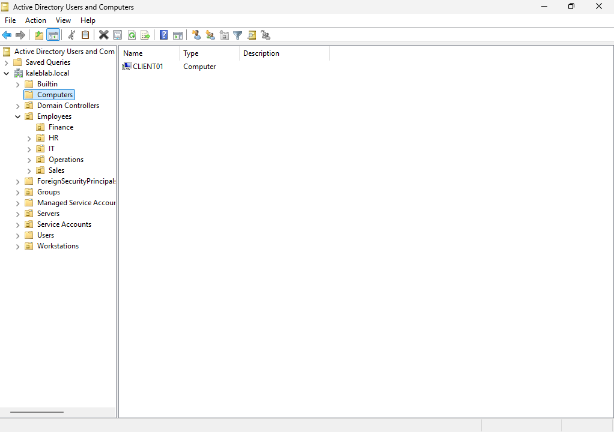

This demonstrates centralized endpoint identity management through Active Directory.

---

# Microsoft Entra Hybrid Identity

## 13. Microsoft Entra Cloud Sync

Microsoft Entra Cloud Sync was configured to connect the on-premises `kaleblab.local` Active Directory environment with Microsoft Entra ID.

The Microsoft Entra Provisioning Agent was installed on DC01 and registered with the Entra tenant.

A group managed service account (gMSA) was used by the provisioning agent for communication with Active Directory.

The Cloud Sync agent successfully registered and reported an active status.

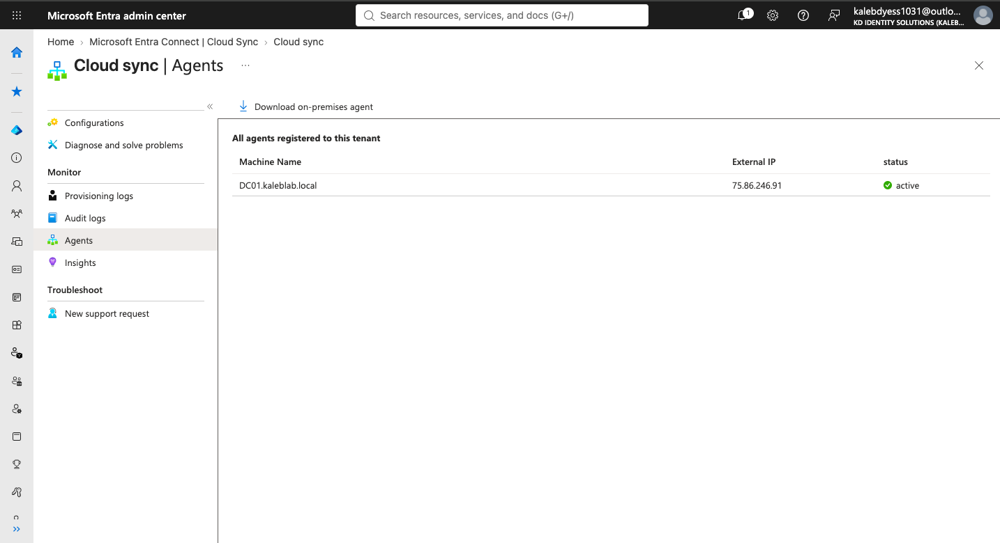

The synchronization configuration was scoped to:

`OU=Employees,DC=kaleblab,DC=local`

This prevents unnecessary synchronization of administrative, service, and infrastructure objects outside of the employee scope.

Password Hash Synchronization was also enabled to support hybrid authentication.

---

## 14. Hybrid Identity Synchronization

Andre Wilson was synchronized from the on-premises Active Directory environment into Microsoft Entra ID.

The Entra user properties confirmed:

- On-premises sync enabled: Yes
- On-premises domain: `kaleblab.local`
- On-premises UPN: `awilson@kaleblab.local`
- On-premises SAM account name: `awilson`
- On-premises distinguished name associated with the Sales and Employees OUs
- Successful on-premises synchronization timestamp

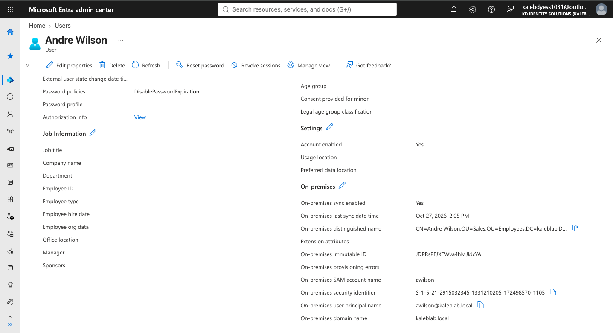

This validates the complete hybrid identity flow:

`Active Directory → Entra Cloud Sync → Microsoft Entra ID`

The user identity can now be centrally managed from the on-premises directory while being represented in the cloud identity environment.

---

# Identity Architecture

The completed environment follows this identity path:

`Active Directory Users`

↓

`Organizational Units and Security Groups`

↓

`Group Policy and Domain Authentication`

↓

`DC01 / kaleblab.local`

↓

`Microsoft Entra Cloud Sync`

↓

`Microsoft Entra ID`

The environment demonstrates how traditional Active Directory infrastructure can integrate with modern cloud identity services.

---

# Security and IAM Design Decisions

## Group-Based Access Management

Users were placed into security groups according to their roles rather than receiving individual permissions.

This supports scalable administration and role-based access control.

## Privileged Account Separation

Administrative identities were separated from standard employee access to reduce privileged-account exposure.

## Organizational Unit Segmentation

Users were organized into OUs to support policy targeting, administration, and synchronization scoping.

## Centralized Policy Enforcement

Group Policy was used to apply employee security controls consistently across domain-joined systems.

## Account Lockout Protection

Repeated failed authentication attempts trigger account lockout controls to reduce brute-force risk.

## Controlled Cloud Synchronization

Cloud Sync was scoped specifically to the Employees OU instead of synchronizing the entire directory.

This follows the principle of minimizing unnecessary identity exposure.

## Hybrid Identity Validation

Synchronization was validated using the user's Entra properties rather than assuming successful synchronization based only on agent status.

---

# Validation Results

| Validation | Result |
|---|---|
| AD DS installation | Successful |
| DNS deployment | Successful |
| `kaleblab.local` domain creation | Successful |
| OU structure | Successful |
| User and security group creation | Successful |
| Privileged group configuration | Successful |
| Employee Security Baseline GPO | Successful |
| Account lockout policy | Successful |
| CLIENT01 domain join | Successful |
| Domain user authentication | Successful |
| Group Policy application | Successful |
| CLIENT01 AD computer object | Successful |
| Entra Cloud Sync agent | Active |
| Employees OU synchronization scope | Successful |
| Password Hash Synchronization | Enabled |
| Hybrid user synchronization | Successful |

---

# Skills Demonstrated

This project demonstrates hands-on experience with:

- Active Directory Domain Services
- Microsoft Entra ID
- Hybrid Identity
- Microsoft Entra Cloud Sync
- Password Hash Synchronization
- Windows Server administration
- Active Directory Users and Computers
- DNS administration
- Organizational Unit design
- User lifecycle administration
- Security group administration
- Group Policy
- Domain-joined endpoints
- Authentication validation
- Least privilege
- Privileged identity separation
- Account lockout controls
- Hybrid identity troubleshooting
- Identity synchronization scoping

---

# Lessons Learned

This project reinforced the dependency relationships between Active Directory, DNS, endpoint configuration, Group Policy, and cloud identity synchronization.

One of the most important lessons was that hybrid identity requires both the on-premises and cloud environments to be correctly configured. DNS resolution, service accounts, administrative permissions, synchronization scope, agent health, and user attributes all affect whether synchronization succeeds.

The project also demonstrated the importance of validating identity systems from multiple perspectives.

Rather than only confirming that configuration screens appeared correct, the environment was tested through:

- Domain-user authentication
- Group Policy results
- Active Directory computer objects
- Cloud Sync agent health
- On-demand provisioning
- Microsoft Entra user synchronization attributes

Troubleshooting the environment also provided practical experience diagnosing DNS, provisioning-agent, authentication, and synchronization issues.

---

# Future Improvements

Future enhancements to the environment could include:

- Microsoft Entra Conditional Access
- Privileged Identity Management
- Joiner-Mover-Leaver automation
- Microsoft Entra ID Governance
- Automated Active Directory administration with PowerShell
- Microsoft Graph automation
- Microsoft Sentinel identity monitoring
- Risk-based identity protection
- Expanded hybrid identity monitoring
- Additional workstation and server objects
- Automated identity lifecycle workflows

These capabilities will be explored in later IAM portfolio projects.

---

# Repository Structure

```text
active-directory-hybrid-identity/
│
├── README.md
│
└── screenshots/
    ├── 01-ADDS-DNS-Installation-Success.png
    ├── 02-Active-Directory-Domain-Created.png
    ├── 03-DNS-Resolution-Verification.png
    ├── 04-OU-Structure.png
    ├── 05-User-Group-Membership.png
    ├── 06-Privileged-Admin-Membership.png
    ├── 07-Employee-Security-Baseline-GPO.png
    ├── 08-Account-Lockout-Policy.png
    ├── 09-CLIENT01-DomainJoin-Success.png
    ├── 10-CLIENT01-DomainUser-Login.png
    ├── 11-CLIENT01-GPO-Applied.png
    ├── 12-DC01-CLIENT01-ComputerObject.png
    ├── 13-Entra-CloudSync-Agent-Healthy.png
    └── 14-Entra-HybridUser-Synced.png
```

---

# Security Notice

All identities, domains, systems, and organizational information shown in this repository are part of a controlled lab environment created for educational and portfolio purposes.

No production credentials, systems, or sensitive organizational information are included.

---

## Author

**Kaleb Dyess**

Information Science & Technology  
Cybersecurity / Identity and Access Management
